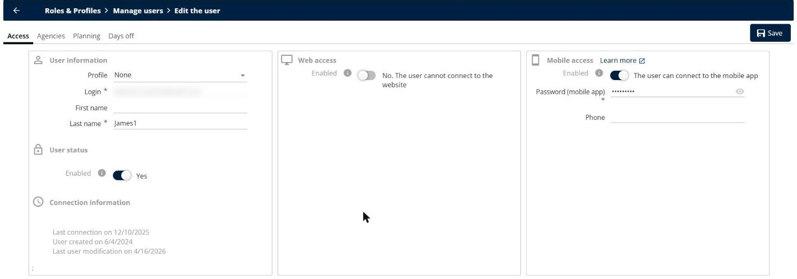
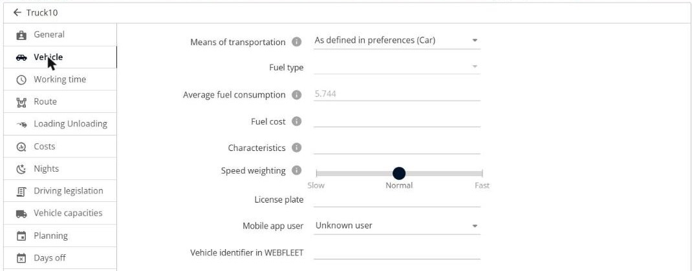
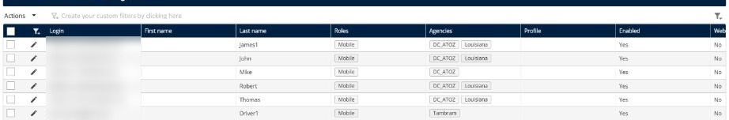

# Impossible de se connecter à l’application mobile

### Prise en main

Si un livreur ne peut pas se connecter à l’application mobile TourSolver, la cause vient généralement de l’identifiant, du mot de passe ou des paramètres de l’utilisateur dans le back-office TourSolver. Cette page aide le livreur et l’administrateur du back-office à trouver et à corriger la cause.

* **Avant de commencer** :
  * Le livreur a installé l’application TourSolver depuis l’**App Store** (iOS) ou le **Google Play Store**. Voir [Connexion](/broken/pages/f7bb0b723430d616e0bde4be923d10fad3a9fbbf).
  * L’administrateur peut se connecter au back-office TourSolver avec un accès à **Configuration**.

### Explications des fonctionnalités et avantages

* **Accès mobile** : Le paramètre de l’utilisateur qui autorise la connexion à l’application mobile. Lorsqu’il est activé, l’utilisateur peut se connecter avec l’identifiant et le mot de passe enregistrés dans le back-office.
* **Mot de passe (application mobile)** : Le mot de passe que le livreur saisit dans l’application. L’administrateur le définit dans le back-office.
* **Utilisateur de l’application mobile** : Le lien entre un livreur du back-office et l’utilisateur qui conduit. Les tournées du livreur sont envoyées à cet utilisateur.
* **Agences** : L’utilisateur et le livreur doivent appartenir à la même agence, pour que l’utilisateur voie les tournées du livreur.

### Tâches courantes avec étapes détaillées

*   **Vérifier l’identifiant et le mot de passe (livreur)**

    1. Dans le champ **Identifiant**, saisissez l’identifiant de votre compte TourSolver exactement comme il vous a été communiqué, en général une adresse e-mail.
    2. Dans le champ **Mot de passe**, saisissez votre mot de passe, puis appuyez sur l’**icône en forme d’œil** pour le vérifier.
    3. Vérifiez les majuscules, et assurez-vous qu’il n’y a pas d’espace avant ou après l’identifiant ou le mot de passe.
    4. Appuyez sur **Connexion**.

    ⚠️ **Attention** : Si le message « **Nom d’utilisateur ou mot de passe incorrect** » apparaît, contactez l’administrateur du back-office TourSolver. Seul l’administrateur peut modifier votre mot de passe.
* **Vérifier l’accès mobile de l’utilisateur (administrateur)**
  1. Dans le back-office TourSolver, accédez à **Configuration** > **Rôles et profils** > **Gérer les utilisateurs**.
  2. Cliquez sur l’icône **Modifier** de l’utilisateur.
  3. Dans l’onglet **Accès**, vérifiez que l’utilisateur est **Activé** et que l’**Accès mobile** est activé : « L’utilisateur peut se connecter à l’application mobile ».
  4. Vérifiez ou réinitialisez le **Mot de passe (application mobile)**, puis cliquez sur **Enregistrer**. Communiquez le nouveau mot de passe au livreur.
  5. Consultez **Dernière connexion le** pour savoir quand l’utilisateur s’est connecté pour la dernière fois.

* **Associer l’utilisateur au livreur (administrateur)**
  1. Dans le back-office TourSolver, accédez à **Mes livreurs**.
  2. Cliquez sur l’icône **Modifier** du livreur, puis sur l’onglet **Véhicule**.
  3. Dans **Utilisateur de l’application mobile**, sélectionnez l’utilisateur du livreur. Si **Utilisateur inconnu** s’affiche, les tournées de ce livreur ne sont envoyées à aucun conducteur.
  4. Cliquez sur **Enregistrer**.

* **Vérifier les agences (administrateur)**
  1. Dans **Configuration** > **Rôles et profils** > **Gérer les utilisateurs**, vérifiez la colonne **Agences** de l’utilisateur.
  2. Vérifiez que le livreur appartient à l’une de ces agences, dans l’onglet **Général** du livreur dans **Mes livreurs**.
  3. Si les agences ne correspondent pas, modifiez les agences de l’utilisateur dans l’onglet **Agences**, puis cliquez sur **Enregistrer**.

### Dépannage

* **« Nom d’utilisateur ou mot de passe incorrect »** : Vérifiez les majuscules et les espaces, puis demandez à l’administrateur de vérifier le **Mot de passe (application mobile)**.
* **L’utilisateur peut se connecter mais ne voit aucune tournée** : Vérifiez que l’utilisateur est l’**Utilisateur de l’application mobile** du livreur, et qu’ils appartiennent à la même agence. Voir aussi [Partager une tournée avec l’application mobile](https://nomadia-docs.gitbook.io/products/toursolver/fr/operations-and-route-management/share-a-tour-with-the-mobile-app).
* **L’application ne s’ouvre pas ou se ferme à la connexion** : Mettez à jour l’application TourSolver depuis l’**App Store** ou **Google Play**, et vérifiez que l’appareil respecte la configuration requise : **Android 8 à 14**, ou **iOS 15.5 ou version ultérieure**.

### Conseils de productivité

* 💡 **Même identifiant que le back-office** : L’identifiant de l’application est l’identifiant de l’utilisateur dans le back-office. Copiez-le depuis **Gérer les utilisateurs** pour éviter les fautes de frappe.
* 💡 **Tenez l’application à jour** : Activez les mises à jour automatiques de l’application TourSolver sur l’appareil, pour que le livreur dispose toujours de la dernière version.
