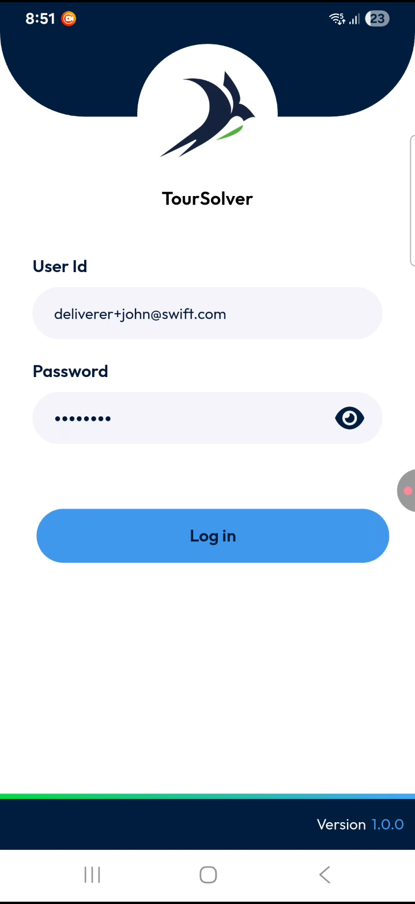

# Connexion

### Commencer

Pour garantir la meilleure expérience avec l'application Nomadia TourSolver, veuillez vérifier les exigences système de votre appareil.

* **Exigences Système** L'application Nomadia TourSolver est conçue pour fonctionner sur divers appareils mobiles. Pour garantir la meilleure expérience, vérifiez si votre appareil respecte les exigences suivantes :
  * **Android** les appareils doivent exécuter **la version 8 à 14**.
  * **iOS** (Apple) les appareils doivent exécuter **la version 15.5 ou ultérieure**.
* **Étapes d'installation et de configuration** Installer l'application Nomadia TourSolver sur votre appareil est rapide et facile !
  1. **Télécharger l'application**: Vous pouvez télécharger l'application Nomadia TourSolver depuis soit le **App Store iOS** (pour les appareils Apple) ou le **Google Play Store** (pour les appareils Android).
  2. **Lancer l'application**: Après le téléchargement, trouvez l' **icône TourSolver** sur l'écran principal de votre appareil et **appuyez dessus** pour ouvrir l'application.

.png>)

* **Configuration initiale : Aperçu de l'écran de connexion** Lorsque vous lancez l'application pour la première fois, vous verrez toujours l' **écran de connexion**. Cet écran est l'endroit où vous saisirez vos informations pour accéder à l'application. Il comprend plusieurs éléments clés :
  * **Champ ID utilisateur**: C'est ici que vous saisirez votre identification utilisateur unique.
  * **Champ Mot de passe**: C'est ici que vous saisirez votre mot de passe secret.
  * **Bouton de connexion bleu**: Situé au centre de l'écran, vous appuierez sur ce bouton après avoir saisi vos informations.
  * **Numéro de version de l'application**: Vous le trouverez affiché en bas à droite de l'écran.

### Explications des fonctionnalités avec avantages

* **Basculer la visibilité du mot de passe (icône œil)** Le **champ de mot de passe** comprend un pratique **icône œil**. Cette fonctionnalité vous permet de **basculer la visibilité de votre mot de passe saisi**. Cela signifie que vous pouvez temporairement voir les caractères que vous tapez pour vous assurer de ne pas avoir fait d'erreur, puis les masquer à nouveau pour la sécurité.
  * 💡 **Conseil**: Utilisez l'icône œil pour vérifier votre mot de passe avant d'appuyer sur **Connexion**, surtout si vous avez des difficultés à vous connecter !

### Tâches courantes avec étapes détaillées

* **Se connecter à l'application** Votre **identifiant utilisateur et mot de passe** sont définis par votre **administrateur back office TourSolver**. Si vous devez un jour **changer votre mot de passe**, veuillez **contacter votre administrateur** directement. Voici comment vous connecter :
  1. **Saisir vos informations**: Appuyez dans le **champ ID utilisateur** et tapez votre identifiant utilisateur. Ensuite, appuyez dans le **champ Mot de passe** et tapez votre mot de passe.
  2. **Appuyer sur Connexion**: Une fois les deux champs remplis, **appuyez sur le bouton de connexion bleu**.

3. **Connexion réussie**: Si votre identifiant utilisateur et votre mot de passe sont corrects, vous serez **authentifié avec succès et connecté à l'application**.

* **Dépannage : Connexion incorrecte** Parfois, vous pouvez faire une faute de frappe ou oublier votre mot de passe. Ne vous inquiétez pas, l'application vous le indiquera !
  * Si le **nom d'utilisateur ou le mot de passe que vous avez saisi est incorrect**, un message d'erreur indiquant "**Nom d'utilisateur ou mot de passe incorrect**" apparaîtra. Ce message sera affiché entre le champ de mot de passe et le bouton de connexion.
  * ⚠️ **Avertissement**: Si vous voyez ce message, vérifiez à nouveau votre identifiant utilisateur et votre mot de passe pour les fautes de frappe, et assurez-vous que la touche Verr Maj n'est pas activée par inadvertance.

### Conseils de productivité

* 💡 **Gestion des mots de passe**: N'oubliez jamais que votre **administrateur back office TourSolver** est le contact principal pour tout changement de mot de passe ou problème. N'hésitez pas à les contacter si vous rencontrez des problèmes persistants de connexion.
* 💡 **Vérification rapide**: Utilisez l’ **icône œil** à côté du champ de mot de passe pour vérifier rapidement votre saisie de mot de passe avant d'appuyer sur **Connexion**. Cela peut vous faire gagner du temps si vous avez tendance à faire des fautes de frappe.
