# Collecte

### 1. Prise en main

Pour commencer à utiliser l’application TourSolver Mobile, suivez ces étapes.

#### Configuration requise et installation

Veuillez noter que des **exigences système** et **étapes d’installation/configuration** pour l’application TourSolver Mobile ne sont pas détaillées dans les sources fournies. Vous devrez peut‑être consulter une documentation supplémentaire ou votre administrateur informatique pour cette information.

#### Démarrer une intervention

1. Une fois l’application installée et que vous êtes prêt à commencer votre travail, initier une intervention est simple :

2. Un **pop‑up de confirmation** apparaîtra.

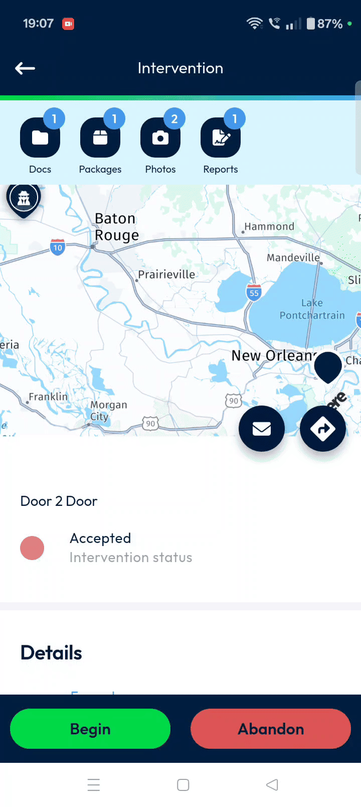

***

### 2. Fonctionnalités clés et avantages

L’interface de l’application TourSolver Mobile est conçue pour une navigation rapide et des mises à jour en temps réel.

**Espace réservé pour l’illustration visuelle :**

* **Aperçu de l’écran principal d’intervention**: Cette illustration montrerait l’écran principal d’intervention, mettant en évidence la rangée d’icônes de navigation en haut, les icônes d’accès rapide et la section des détails de l’intervention. Cela fournirait un aperçu utile de l’interface décrite ci‑dessous.

#### Sections de navigation (icônes en haut)

Juste en dessous des icônes de navigation principales, vous trouverez une rangée d’icônes qui vous permettent de passer facilement entre les différentes parties de votre intervention. Chaque icône peut afficher un petit **badge bleu** indiquant le nombre d’éléments ajoutés à cette section, vous donnant un aperçu rapide de votre progression.

* **Docs**: Ici, vous pouvez **téléverser et consulter des documents importants** liés à votre intervention. Cela permet de garder toute la paperasse nécessaire organisée et accessible.
* **Colis**: Cette section vous permet de **gérer le chargement et le déchargement des colis**, crucial pour les tâches de collecte.
* **Photos**: Facilement **prendre ou téléverser des images** directement depuis le terrain, parfait pour capturer une preuve de livraison ou l’état du site.
* **Remarques**: Utilisez cette zone pour **saisir des commentaires ou notes** pertinents à l’intervention.
* **Rapports**: C’est ici que vous pouvez **téléverser le rapport officiel d’intervention**.
* **Signature**: Capturez la **reconnaissance ou la signature du client** directement sur votre appareil.

<figure><figcaption></figcaption></figure>

#### Outils d’accès rapide

Sous les icônes de navigation principales, vous verrez le **badge globe** et deux icônes d’accès rapide pour des actions immédiates.

* **Badge Globe**: Ce badge fournit un aperçu rapide de votre **contexte géographique actuel**, vous montrant exactement où l’intervention est située.
* **Icône Email**: Appuyez dessus pour **envoyer rapidement des mises à jour ou contacter les parties concernées**.

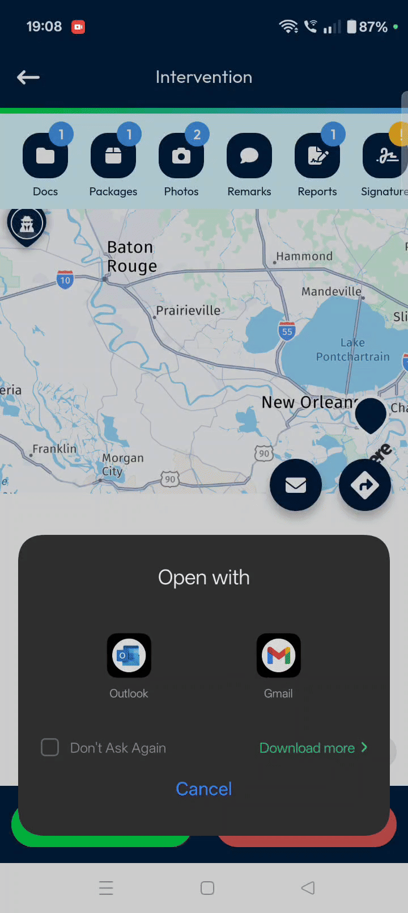

* **Bouton de navigation**: Situé à côté de l’icône email, en appuyant dessus vous ouvrez votre **application de cartographie préférée**, fournissant un guidage d’itinéraire instantané vers le site de l’intervention.

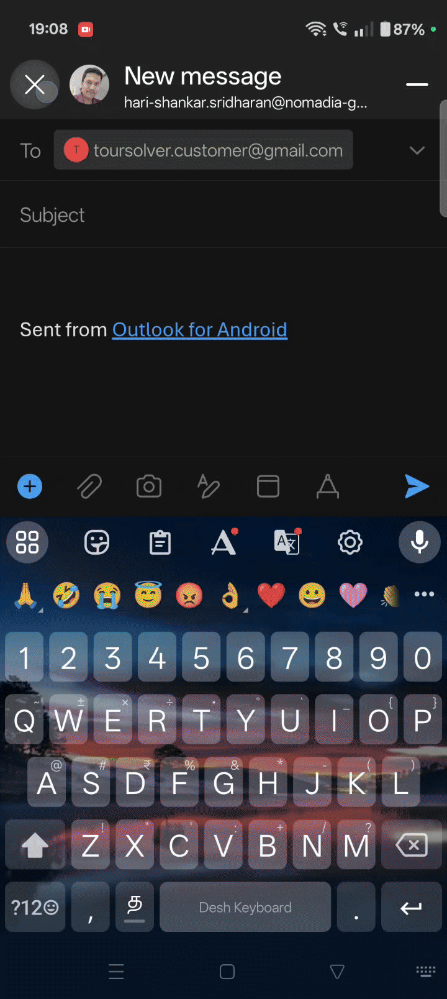

#### Détails de l’intervention

Sous ces icônes, vous trouverez des détails essentiels sur votre intervention en cours :

* **Informations clés**: Comprend le **titre de l’intervention**, son **statut**, **heure de début**, **heure de fin**, et un **chronomètre**.
* **Détails supplémentaires**: Fournit des informations plus spécifiques telles que le **nom du site**, **adresse**, **titre de l’intervention**, **date et heure**, **heure d’arrivée annoncée**, **durée estimée**, **noms des participants**, et **référence externe**.

***

### 3. Instructions étape par étape

Cette section vous guide à travers les actions les plus fréquentes que vous effectuerez dans l’application TourSolver Mobile.

#### Gestion des documents (section Docs)

La section Docs vous permet de gérer toute la paperasse nécessaire de manière numérique.

1. Appuyez sur **Docs** pour téléverser les documents pertinents.
2. Pour consulter un document, appuyez simplement dessus pour l’ouvrir.

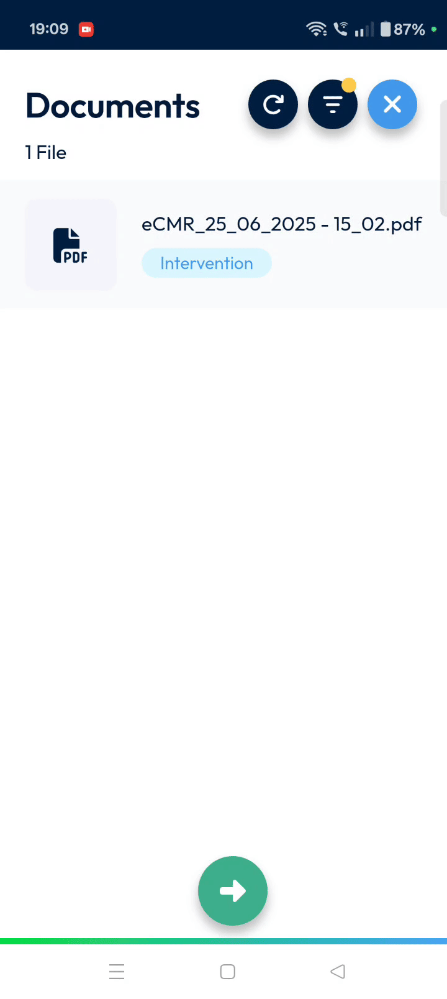

💡 **Conseil**: Utilisez l’ **icône de filtre** en haut pour trier votre liste de documents par intervention ou par site, vous aidant à trouver des documents spécifiques plus rapidement. Après avoir sélectionné votre filtre, n’oubliez pas d’appuyer sur **Appliquer**.

#### Scan et gestion des colis (section Colis)

Ceci est crucial pour une gestion précise des Collectes.

<figure><figcaption></figcaption></figure>

<figure><figcaption></figcaption></figure>

1. Vous verrez des informations telles que : **Date et heure de collecte par le client**, **date et heure de livraison au client**, **nom de la commande**, et **nom et adresse du client**.
2. Vous pouvez également saisir des **remarques** dans la **zone de commentaire** prévue.
3. Appuyez sur le bouton Enregistrer en bas pour mettre à jour les modifications.

**Espace réservé pour l’illustration visuelle :**

* **Numérisation et détails du colis**]: Cette illustration pourrait montrer l’interface de numérisation des colis avec un cercle vert indiquant une numérisation réussie, puis une vue détaillée d’une carte de colis avec ses champs d’information. Cela clarifie le processus de numérisation et de saisie des données.

#### Capturer et téléverser des photos (section Photos)

Documentez votre travail avec des images claires.

1. Appuyez sur le **scanner** pour scanner le code QR

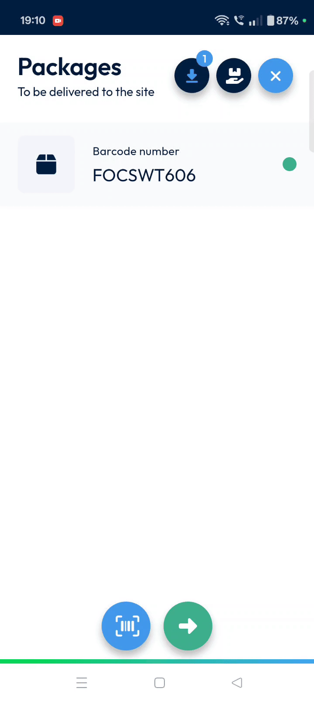

2. Une fois scanné, le numéro de code‑barres apparaîtra avec un cercle vert à côté."

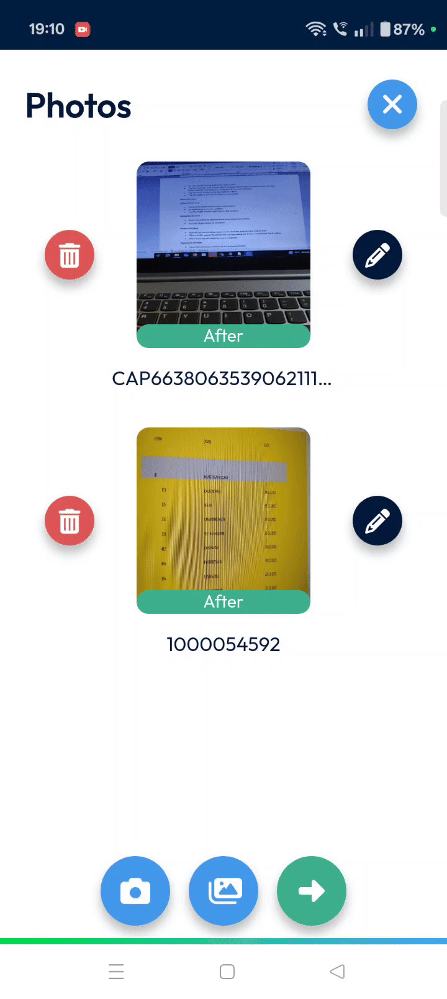

Appuyez sur les photos

#### Capturer et téléverser des photos (section Photos)

1. Documentez votre travail avec des images claires.

2. Appuyez sur **Caméra** icône pour prendre une photo

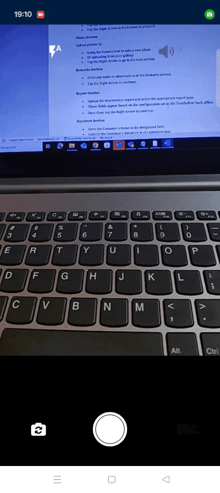

3. Sélectionnez la **coche** pour confirmer et téléverser la photo."

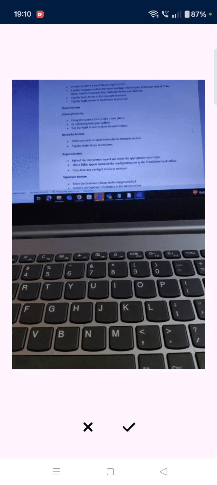

4. Appuyez sur **photo** icône pour téléverser une image depuis la galerie

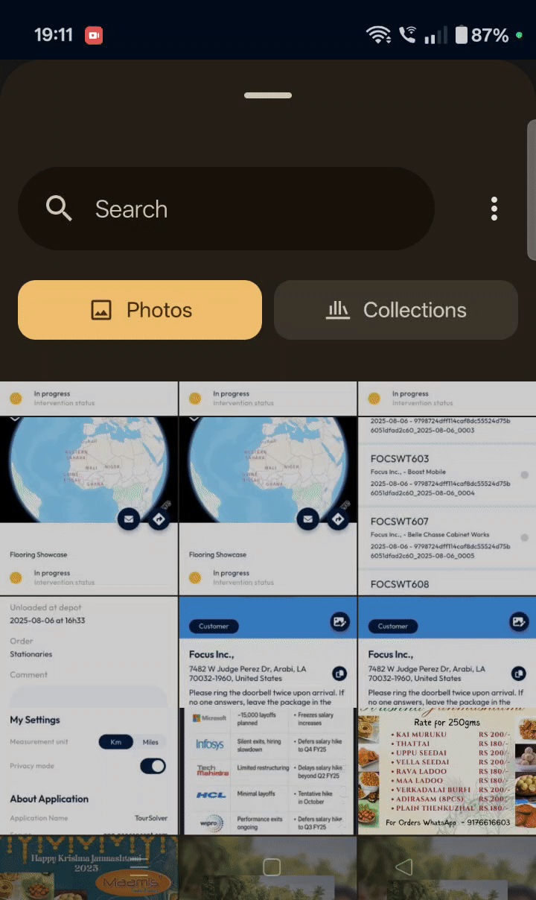

5. Appuyez sur **Enregistrer** pour mettre à jour les modifications

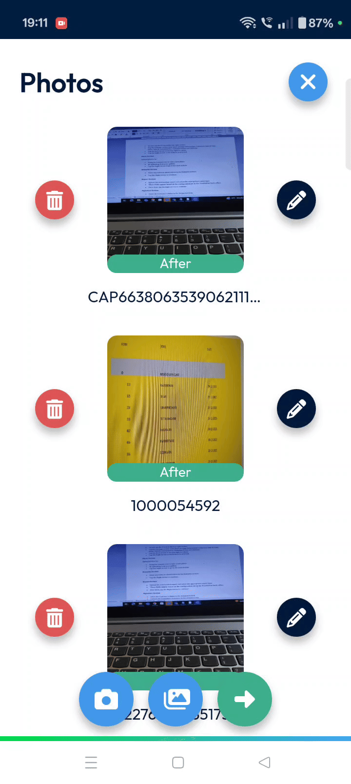

#### Ajouter des remarques générales (section Remarque)

Fournissez un contexte ou des notes importants pour le back office.

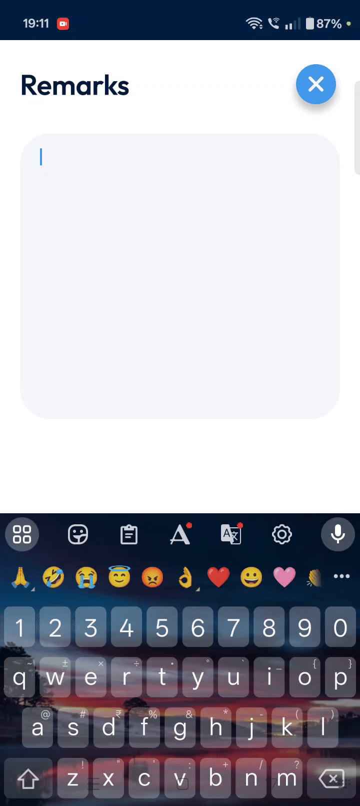

#### Téléverser les rapports d’intervention (section Rapport)

Complétez votre documentation officielle.

1. **Téléversez le rapport d’intervention.**

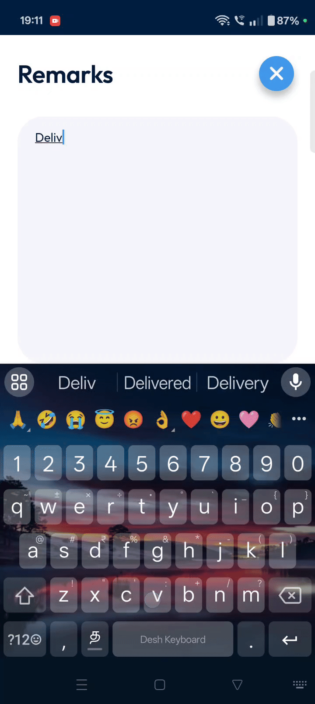

2. **Sélectionnez le type de rapport approprié**.

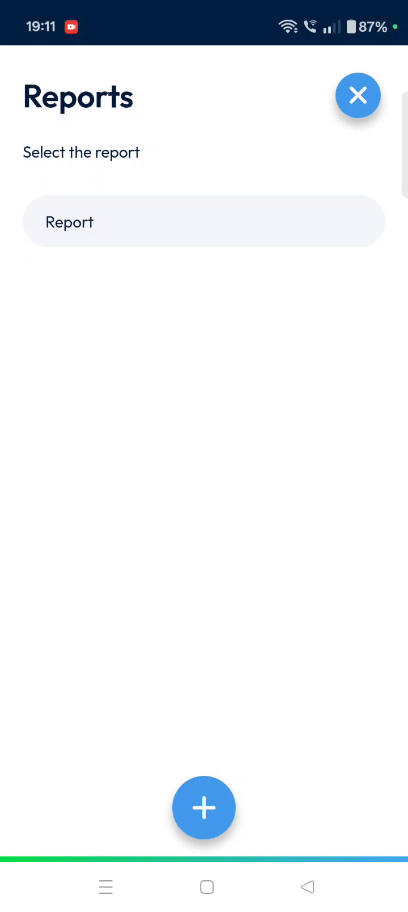

\
3\. **Remplissez les détails nécessaires sous l’option de rapport pertinente. Les champs affichés ici dépendent de la configuration définie dans le back office**

<figure>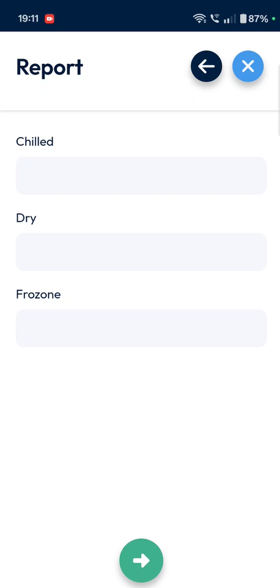<figcaption></figcaption></figure>

#### Capturer les signatures des clients (section Signature)

Sécurisez facilement la reconnaissance du client.

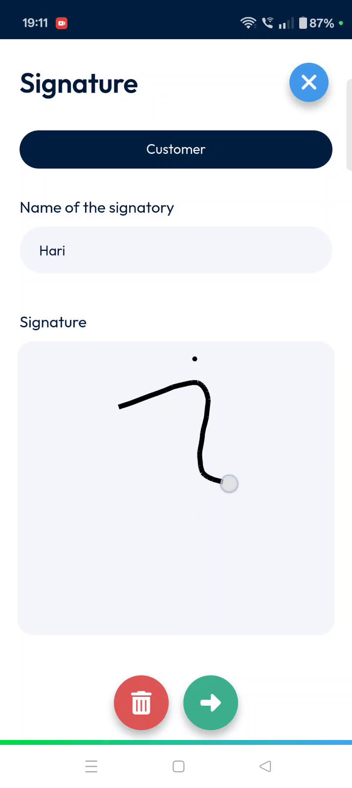

**Espace réservé pour l’illustration visuelle :**

* \[**Capture d’écran/diagramme suggéré 3 : Capture de signature**]: Cette illustration montrerait l’écran de capture de signature avec le champ du nom du client et la zone de signature, démontrant comment les reconnaissances sont collectées.

#### Clôturer l’intervention

1. Finalisez votre travail et synchronisez‑le avec le back office.

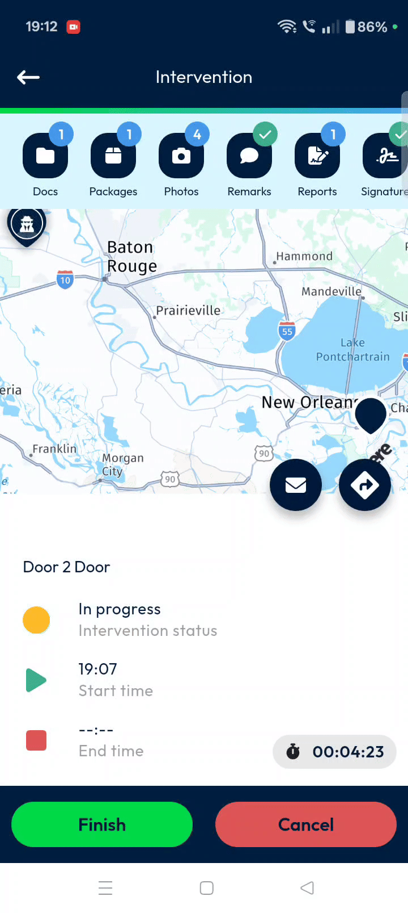

2. Un **pop‑up de confirmation** apparaîtra.

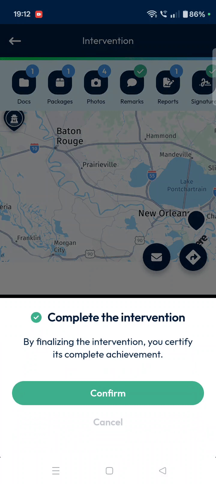

3. Une fois que vous appuyez sur **confirmer**, le statut sera changé en terminé

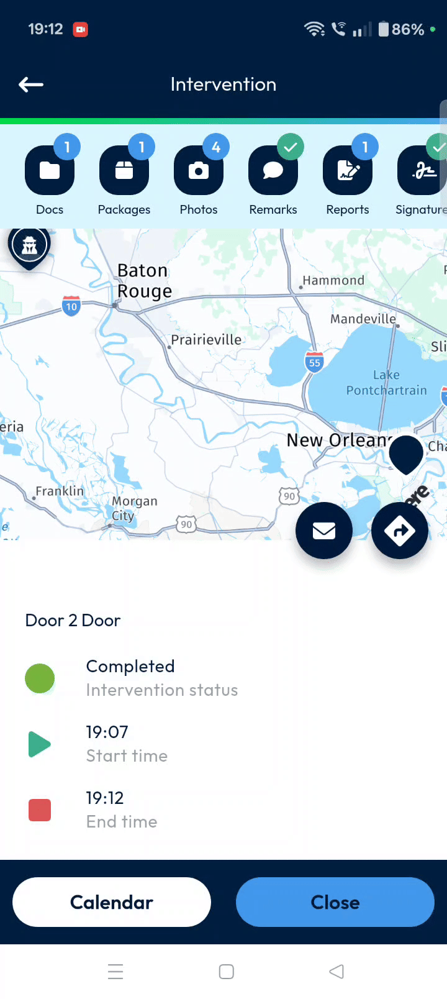

### 4. Conseils de productivité

* **Restez informé avec les badges**: Gardez un œil sur les **petits badges bleus** sur chaque icône. Ils vous indiquent rapidement combien d’éléments (documents, photos, colis) vous avez ajoutés à chaque section, vous aidant à suivre votre progression d’un coup d’œil.
* **Utilisez l’accès rapide pour la communication**: N’oubliez pas l’ **icône email** pour une communication rapide. Cela peut vous faire gagner du temps lorsque vous devez envoyer une mise à jour rapide ou contacter quelqu’un directement depuis le site de l’intervention.
* **Naviguez efficacement**: Le **bouton de navigation** est votre meilleur allié pour vous rendre à votre prochain site. Il s’intègre à votre application de cartographie préférée, garantissant que vous ayez toujours l’itinéraire le plus efficace.
* **Des enregistrements détaillés sont essentiels**: Faites bon usage de la **section Remarques** et du **zone de commentaire** au sein des détails du colis. Des notes détaillées fournissent un contexte précieux pour votre équipe et aident à résoudre toute question future.
* **Vérifiez la configuration du back office**: N’oubliez pas que les champs de rapport sont basés sur les **configurations du back office TourSolver**. Si vous rencontrez des champs inattendus ou avez besoin de types de rapports spécifiques, il est conseillé de vérifier auprès de votre équipe back office.
