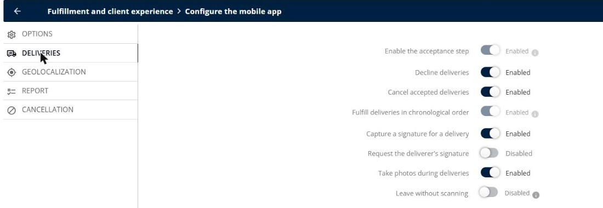

# Refuser ou annuler une visite sans prévenir le client

### Prise en main

Un livreur peut refuser une visite qu’il ne peut pas effectuer, ou annuler une visite qu’il a déjà acceptée. Cette page explique comment le faire sans envoyer au client la notification « Arrivée imminente », et ce qu’il faut vérifier lorsqu’une mission ne peut pas être modifiée dans l’application.

* **Avant de commencer** :
  * Le livreur peut ouvrir la visite dans l’application. Voir [Annuler](/broken/pages/089174fabae1ac7e2d5124985753c2c1f42bfbd5).
  * L’administrateur peut se connecter au back-office TourSolver avec un accès à **Configuration**.

### Explications des fonctionnalités et avantages

* **Refuser les livraisons** : Permet au livreur de refuser une visite avant de l’accepter. Le client ne reçoit pas la notification « Arrivée imminente » pour une visite refusée.
* **Annuler les livraisons acceptées** : Permet au livreur d’annuler une visite après l’avoir acceptée. La notification « Arrivée imminente » a peut-être déjà été envoyée.
* **Activer l’étape d’acceptation** : L’étape au cours de laquelle le livreur accepte la visite. Elle est obligatoire lorsque la notification « Arrivée imminente » au client est activée.
* **Configuration de modification des missions** : Définit les missions qu’un utilisateur peut modifier dans l’application.

### Tâches courantes avec étapes détaillées

* **Autoriser les livreurs à refuser une visite (administrateur)**
  1. Dans le back-office TourSolver, accédez à **Configuration** > **Suivi et expérience client** > **Configurer l’application mobile**.
  2. Cliquez sur **LIVRAISONS**.
  3. Activez **Refuser les livraisons**.
  4. Si nécessaire, activez **Annuler les livraisons acceptées**.

⚠️ **Attention** : **Activer l’étape d’acceptation** ne peut pas être désactivé tant que l’« E-mail/SMS sortant d’arrivée imminente au client » est activé. Pour la désactiver, décochez d’abord cette notification dans **Configurer les messages sortants** > **Arrivée imminente**.

*   **Refuser une visite sans prévenir le client (livreur)**

    1. Ouvrez la visite depuis le **Tableau de bord**.
    2. **Refusez** la visite avant de l’accepter.

    💡 **Conseil** : Refusez la visite au lieu de l’accepter puis de l’annuler. Lorsque vous acceptez une visite, le client peut recevoir la notification « Arrivée imminente ».
* **Annuler une visite acceptée (livreur)**
  1. Ouvrez la visite, puis appuyez sur le bouton d’annulation.
  2. Confirmez l’annulation. Voir [Annuler](/broken/pages/089174fabae1ac7e2d5124985753c2c1f42bfbd5).

### Dépannage

* **Le livreur ne peut pas refuser une visite** : Vérifiez que **Refuser les livraisons** est activé dans **Configurer l’application mobile** > **LIVRAISONS**.
* **Le client a reçu la notification « Arrivée imminente »** : Le livreur a accepté la visite avant de l’annuler. Demandez au livreur de refuser les visites à la place.
* **La mission ne peut pas être modifiée dans l’application** :
  * Vérifiez les droits de modification de l’utilisateur dans les paramètres des donneurs d’ordre du back-office.
  * Vérifiez que le type de mission est compatible avec la configuration de modification des missions de l’utilisateur. Si aucune configuration de modification des missions n’est compatible avec le type de mission, TourSolver affiche « None of your mission edit configurations are compatible with the selected mission types. », et les missions de ce type ne sont pas modifiables.

### Conseils de productivité

* 💡 **Refusez tôt** : Refusez les visites que vous ne pouvez pas effectuer dès que vous les voyez, pour que le planificateur puisse les affecter à un autre livreur.
* 💡 **Demandez à votre administrateur** : Les options de refus et d’annulation se règlent dans le back-office. Si vous ne les voyez pas dans l’application, contactez votre administrateur.
