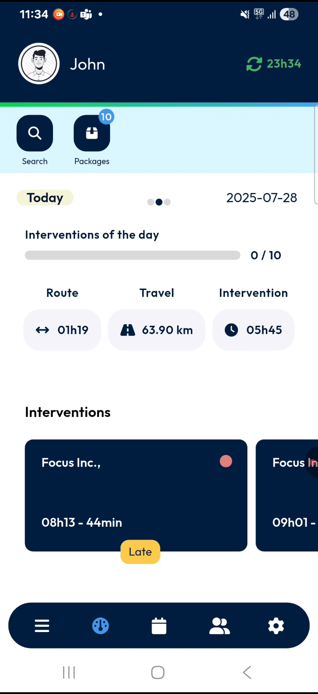
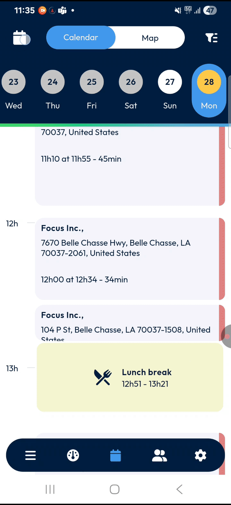
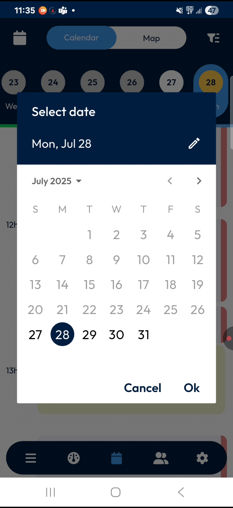
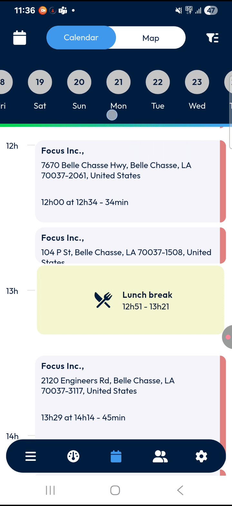
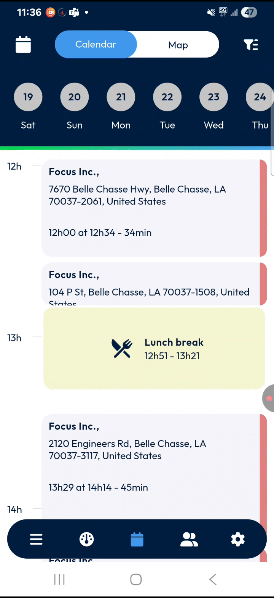
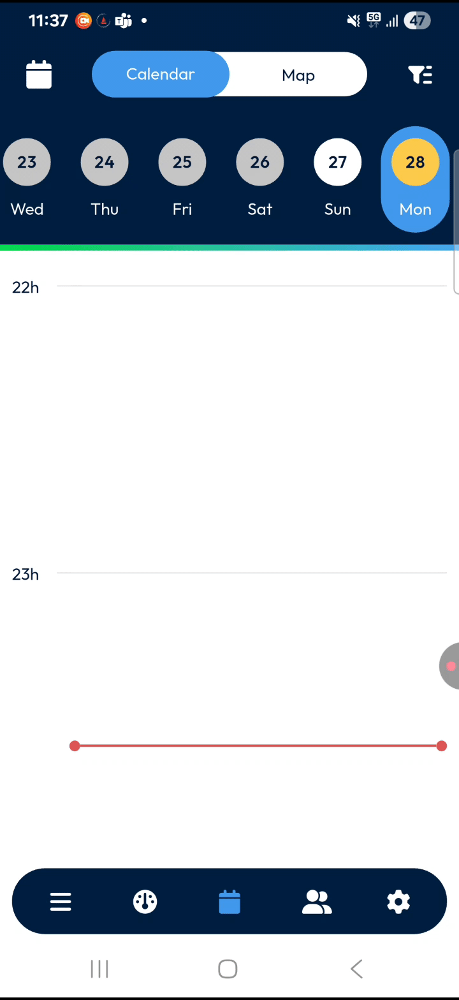
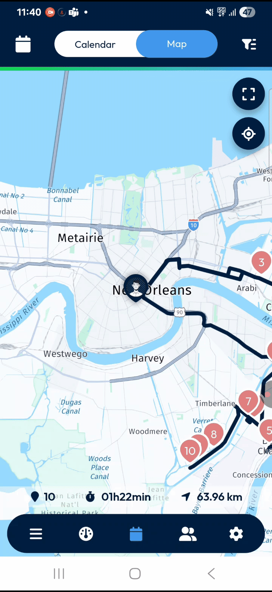
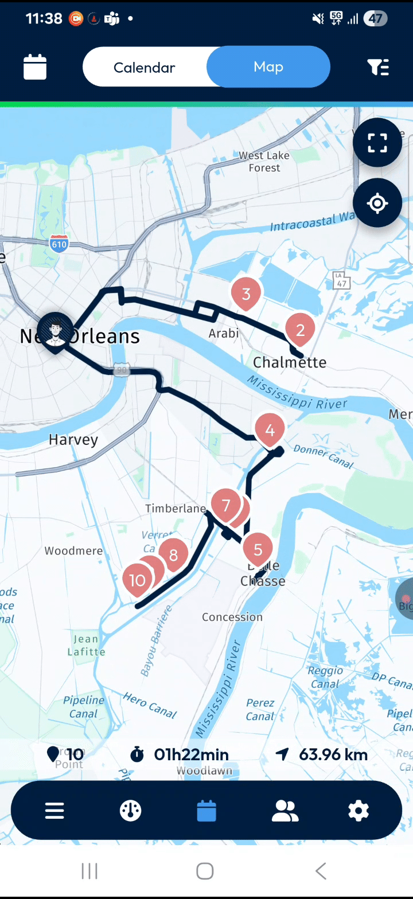

# Calendrier

### 1. Commencer&#x20;

L'écran du calendrier est votre centre névralgique pour visualiser et gérer toutes vos activités planifiées, qu'elles soient pour aujourd'hui ou pour l'avenir.

* **Exigences système et installation/configuration :** Les sources fournies ne précisent pas les exigences système ni les étapes détaillées d'installation/configuration pour l'application TourSolver Mobile. Veuillez vous référer au service informatique de votre organisation ou à la fiche de l'application sur le store pour ces informations.
* **Configuration initiale : Ouverture du calendrier** Votre parcours commence depuis le tableau de bord principal de l'application.
  1. Recherchez les principaux boutons d'action en **bas** de l'écran de votre application.
  2. **Appuyez** sur le **bouton calendrier**.

### 2. Explication des fonctionnalités et avantages

Le calendrier de TourSolver Mobile offre des fonctionnalités puissantes pour vous maintenir organisé et efficace.

* **Vue quotidienne (par défaut) :**
  * **Avantage :** Fournit un aperçu immédiat de l'emploi du temps de votre journée en cours, incluant les interventions client et des événements comme le déjeuner ou les briefings.
  * **Détails :** Affiche les interventions sous forme de **cartes**. Une ligne horizontale rouge montre la chronologie actuelle, vous aidant à voir où vous en êtes dans votre journée.
* **Sélection de la date :**
  * **Avantage :** Vous permet de visualiser facilement les interventions pour une date spécifique, passée (si activée) ou future.
  * **Détails :** Accessible via l' **icône calendrier** en haut à gauche de l'écran du calendrier.
* **Vue Calendrier (Cartes) :**
  * **Avantage :** Présente une vue claire, semblable à une liste, de toutes les interventions pour une date sélectionnée, détaillant les informations client et les horaires.
  * **Détails :** Chaque intervention est affichée comme une **carte**, montrant le nom du client, l'adresse, les heures de début/fin et la durée. Un petit cercle coloré à droite indique le statut actuel de l'intervention. Des événements tels que "pause déjeuner", "briefing", "chargement" et "déchargement" sont également listés.
* **Vue Carte :**
  * **Avantage :** Offre une vue visuelle de votre itinéraire quotidien et de l'emplacement de chaque intervention, vous aidant à comprendre votre plan de déplacement.
  * **Détails :** Affiche votre lieu de départ et toutes les interventions de la journée, numérotées dans l'ordre. Un résumé de l'itinéraire indique le nombre d'interventions, la durée totale et la distance à parcourir. Vous pouvez aussi voir les cartes d'intervention en parallèle de la carte en mode plein écran.
* **Filtres et options d'affichage :**
  * **Avantage :** Personnalisez la manière dont vous visualisez votre planning, en vous permettant de basculer entre les vues jour, semaine ou liste, et d'accéder à des actions importantes.
  * **Détails :** Accessible via l' **bouton filtre** en haut à droite de l'écran.
* **Légende des couleurs des statuts d'intervention :**
  * **Avantage :** Comprenez rapidement le statut de chaque intervention d'un coup d'œil selon sa couleur.
  * **Détails :** La légende des couleurs est accessible en appuyant sur le **bouton filtre**.
    * **Rouge :** Statut en attente.
    * **Rouge clair :** Statut accepté (cela est également indiqué si une carte affiche "votre prochaine visite" comme votre prochaine action).
    * **Jaune :** En cours.
    * **Vert :** Terminé.
    * **Violet foncé :** Refusé.
    * **Violet clair :** Abandonné.

***

### 3. Instructions étape par étape

Voici comment effectuer les actions clés dans le calendrier TourSolver Mobile.

**3.1. Changer la date de vue** Pour voir votre planning pour un autre jour :

1. Depuis l'écran du calendrier, appuyez sur le **icône calendrier** à **en haut à gauche**.

2. Le mois en cours sera affiché avec la date d'aujourd'hui mise en surbrillance.
3. Vous avez plusieurs options pour choisir une autre date :

4\. Une fois que vous avez choisi votre date, appuyez sur **OK** pour confirmer votre sélection ou **Annuler** pour fermer la fenêtre sans changer la date.

**3.2. Basculer entre les vues Calendrier et Carte** Vous pouvez choisir comment vous souhaitez visualiser vos interventions :

1. En haut au centre de l'écran, à côté de l'icône calendrier, vous verrez deux icônes de vue.
2. **Appuyez** l'icône respective pour basculer :

**3.3. Utilisation des filtres et options d'affichage** Pour affiner votre vue ou accéder aux actions :

1. Appuyez sur le **bouton filtre** à **en haut à droite** de l'écran.

2. Depuis ce menu, vous pouvez basculer entre Semaine, Jour et Liste

**3.4. Visualiser les détails d'une intervention en vue Carte**

1. Une fois vos filtres définis, faites défiler vers le bas pour voir toutes vos interventions pour la date sélectionnée.
2. Chaque intervention apparaît comme une **carte**.
3. Sur chaque carte, vous verrez :
   * Le **nom** du client **et**.
   * l'adresse **Heures de** du client **début et de fin de l'intervention**.
   * durée **Un petit** cercle coloré
     * indiquant le statut actuel (reportez-vous à la Légende des couleurs dans le menu filtre). **💡** Astuce :**Si une carte indique "**&#x56;otre prochaine visite
4. ," cela signifie votre prochaine action immédiate. **Pour voir plus de détails et démarrer une tâche,** appuyez sur
   * une carte d'intervention.

**\[Capture d'écran : Exemple de carte d'intervention avec détails mis en évidence]** 3.5. Explorer la vue Carte

1. Appuyez sur le **Pour un aperçu visuel de votre itinéraire :** icône vue carte
2. en haut au centre de l'écran.
   * La carte affichera : **Votre**.
   * lieu de départ **Chaque intervention de la journée,**.
   * numérotée dans l'ordre **Un** résumé d'itinéraire
   * La carte affichera : **incluant le nombre d'interventions, la durée totale et la distance à parcourir.** itinéraire tracé
3. **sur la carte.**

**Vue carte plein écran :** 3.6. Retour à l'écran principal du calendrier **Vous pouvez toujours revenir à l'écran principal du calendrier en appuyant sur la** à **en haut à gauche**.

***

### flèche de retour

4\. Conseils de productivité

* **💡 L'écran du calendrier est conçu pour vous aider à voir et gérer rapidement les interventions pour n'importe quelle date, aujourd'hui ou à l'avenir.** Restez à jour : **Utilisez régulièrement la** "Mettre à jour mon agenda" **fonction (trouvée sous le**bouton filtre > Actions
* **) pour garantir que votre calendrier reflète les derniers changements de votre planificateur. C'est crucial pour une planification précise.** Recherche rapide : **Si vous avez besoin de trouver une intervention spécifique, ne faites pas défiler indéfiniment ! Utilisez l'outil** "Rechercher une intervention" **fonction (trouvée sous le**(aussi sous
* **) pour la localiser rapidement en tapant un nom, un numéro, une date ou une adresse.** Planification visuelle : **Exploitez la** Vue Carte
* **pour comprendre votre itinéraire quotidien et la répartition géographique de vos interventions. Cela peut vous aider à anticiper les temps de trajet et optimiser votre séquence de visites.** Statut en un coup d'œil : **Familiarisez-vous avec la** légende des couleurs
