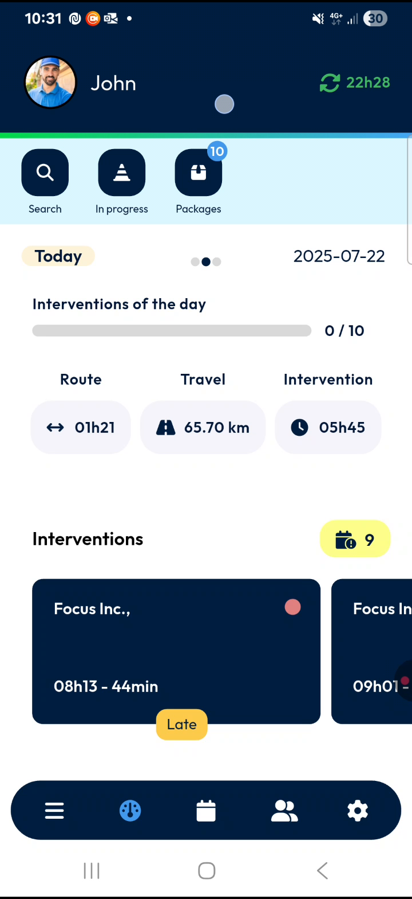
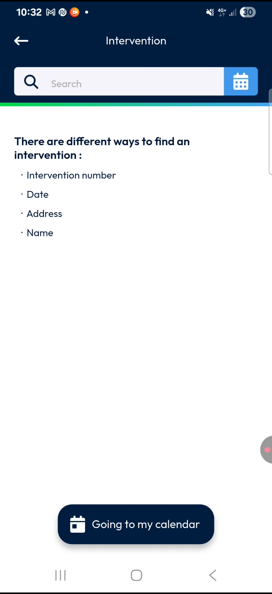
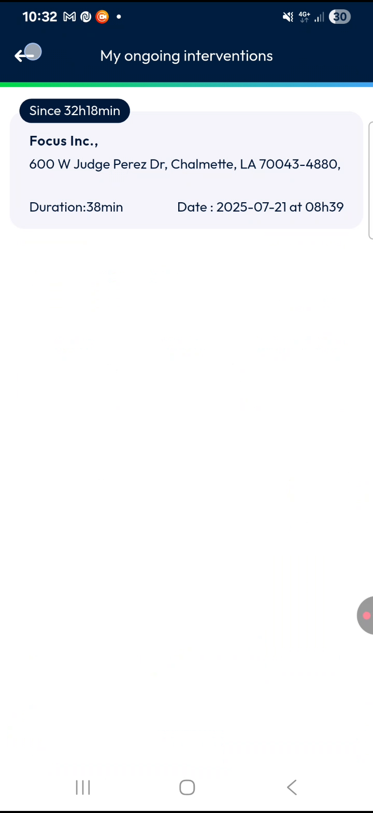
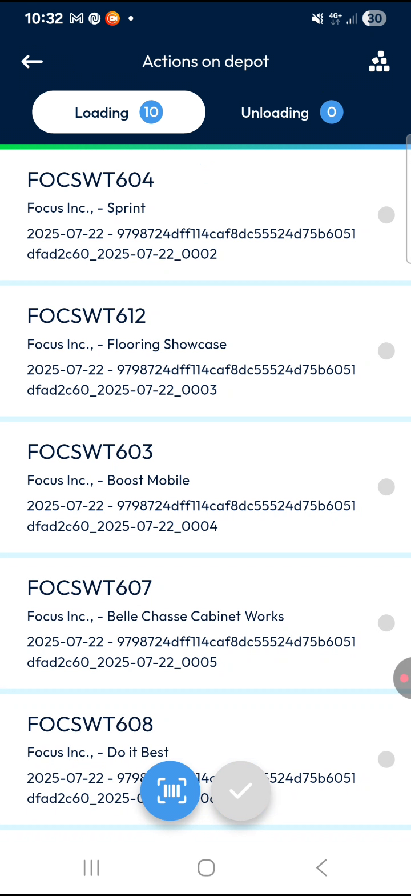
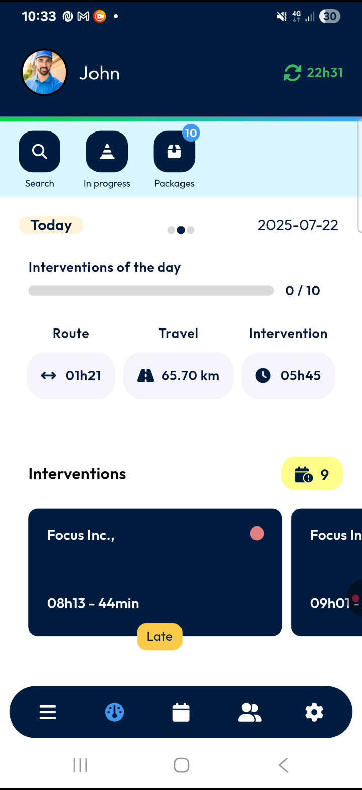
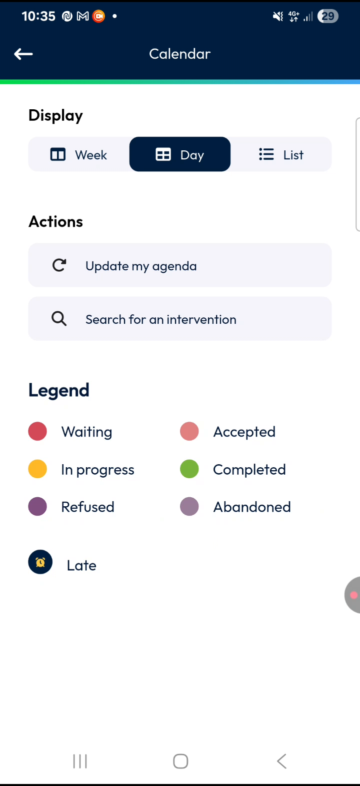
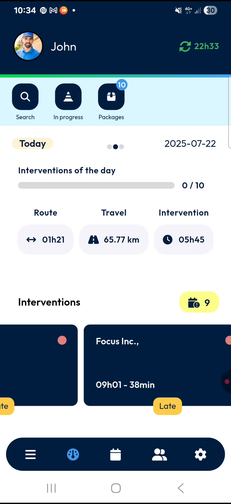

# Tableau de bord

### 1. Prise en main

Après une connexion réussie, vous verrez immédiatement votre **Tableau de bord** écran. Cet écran est conçu pour vous donner un aperçu rapide de vos activités de la journée.

* **Vue initiale après connexion**: Lorsque vous vous connectez pour la première fois, votre tableau de bord affichera votre planning et votre progression. Par exemple, le **Barre de progression** pourrait indiquer "0 sur 10", ce qui signifie que vous avez 10 interventions programmées pour aujourd'hui et qu'aucune n'a encore été effectuée. Cette barre se mettra à jour automatiquement au fur et à mesure que vous terminez des tâches pendant la journée.

### 2. Explications des fonctionnalités et avantages

Le tableau de bord mobile TourSolver regorge de fonctionnalités utiles conçues pour vous aider à gérer efficacement votre journée.

* **Section supérieure : Votre profil et l'état des données**
  * **Avatar et nom**: Dans le **coin supérieur gauche**, vous verrez votre **photo de profil (avatar)** et votre **nom** affiché à côté.
    * **Avantage**: Cela confirme que vous êtes connecté et contribue à personnaliser votre expérience.

* **Heure de synchronisation**: Dans le **coin supérieur droit**, vous pouvez voir la **dernière fois où l'application s'est synchronisée avec succès avec le back office**.
  * **Avantage**: Cela vous indique à quel point vos données sont à jour, garantissant que vous travaillez avec les informations les plus récentes.

* **Boutons d'action rapide : Vos outils quotidiens** Juste en dessous de la section supérieure, ces boutons offrent un accès rapide à des fonctions importantes :
  * **Recherche**: Ce bouton vous permet de **trouver rapidement n'importe quelle intervention** en saisissant un nom de client, un numéro, une date ou une adresse.
    * **Avantage**: Gagne du temps en vous aidant à localiser des tâches spécifiques sans avoir à faire défiler l'ensemble de votre agenda.

* **Interventions en cours**: Ce bouton affiche une **liste de vos interventions actuellement en cours**.
  * **Avantage**: Vous aide à vous concentrer sur les tâches sur lesquelles vous travaillez activement.
    * indiquant le statut actuel (reportez-vous à la Légende des couleurs dans le menu filtre). **Conseil**: Ce bouton n'apparaît que si vous avez des interventions actuellement marquées comme "en cours".

* **Charger les colis**: Ce bouton est utilisé pour **charger tous les colis de livraison sur votre camion** avant de commencer votre tournée pour la journée.
  * **Avantage**: Permet de s'assurer que vous disposez de tous les articles nécessaires avant de commencer vos tâches quotidiennes.

* **Carrousel d'agenda : Votre planning en un coup d'œil** Sous les boutons d'action rapide, vous trouverez un **carrousel d'agenda**.
  * Ceci montre votre **planning pour aujourd'hui**.
  * Vous pouvez **glissez vers la droite** pour voir l'agenda d'hier ou **glissez vers la gauche** pour voir l'agenda de demain.
  * La **jour** (par exemple, "aujourd'hui", "hier" ou "demain") est affiché sur le **côté gauche** du carrousel.
  * La **date réelle** pour le jour sélectionné est affichée sur le **côté droit**.
  * **Avantage**: Fournit une vue claire et flexible de votre planning pour les jours en cours, passés ou à venir.

* **Barre de progression : Suivez votre achèvement quotidien** Sous le carrousel d'agenda, la **barre de progression** représente visuellement **combien d'interventions vous avez terminées aujourd'hui**.
  * Au fur et à mesure que vous terminez des interventions, cette barre se met automatiquement à jour en temps réel.
  * **Avantage**: Offre une mise à jour visuelle immédiate de votre progression, vous aidant à rester motivé et sur la bonne voie.

* **Résumé de la tournée : Vue d'ensemble de votre charge de travail** Juste en dessous de la barre de progression, le **Un** fournit trois informations clés pour votre journée :
  * **Tournée**: Le **distance totale** que vous parcourrez aujourd'hui.
  * **Déplacement**: Le **kilomètres planifiés au total** pour la journée.
  * **l'adresse**: Le **durée totale des interventions** prévue pour la journée.
  * **Avantage**: Vous donne un aperçu rapide et essentiel de votre charge de travail quotidienne, vous aidant à comprendre l'ampleur de vos tâches.

* **Section Intervention : Détails de vos tâches** En faisant défiler vers le bas, vous entrerez dans la **section des interventions** où toutes les tâches de votre journée sont affichées sous forme de **cartes individuelles**.
  * Vous pouvez **faites glisser ces cartes de droite à gauche** pour parcourir toutes vos interventions programmées.
  * À droite de l'étiquette "Intervention", vous verrez un décompte de **combien d'interventions sont en retard aujourd'hui**. Par exemple, il peut indiquer "neuf interventions sont en retard aujourd'hui".
  * Chaque **carte d'intervention** affiche des détails importants :
    * La **nom du client**.
    * La **heure programmée** pour cette intervention.
    * La **durée estimée** de l'intervention.
  * **Cercle coloré**: Un petit **Un petit** dans le coin supérieur droit de chaque carte représente le **statut actuel de l'intervention** (par ex., terminé, accepté).
    * **Avantage**: Fournit une indication visuelle rapide du statut de la tâche.
    * indiquant le statut actuel (reportez-vous à la Légende des couleurs dans le menu filtre). **Conseil**: Vous pouvez trouver la **légende de ces couleurs** dans la **menu Calendrier** sous le **option de filtre**.

* **Indicateur de retard**: Si une tâche est en retard, vous verrez un petit **drapeau rectangulaire jaune "en retard"** au bas au centre de la carte.
  * **Avantage**: Met immédiatement en évidence les tâches en retard, vous aidant à les prioriser.

* **Avantage**: Offre une vue complète et détaillée de chaque tâche, facilitant la consultation de toutes les informations nécessaires en un coup d'œil.

* **Boutons de navigation principaux : Se déplacer dans l'application** Tout en bas du tableau de bord, vous trouverez les **boutons du menu principal**. Ceux-ci vous permettent de passer facilement d'un écran à l'autre dans l'application, y compris :
  * **Menu**
  * **Tableau de bord**
  * **Calendrier**
  * **Prospects et clients**
  * **Paramètres**
  * **Avantage**: Assure une navigation fluide dans l'application mobile TourSolver.

### 3. Instructions étape par étape

Voici comment interagir avec certaines fonctionnalités clés de votre tableau de bord :

* **Consulter votre planning pour différents jours**:
  1. Repérez l'icône **Carrousel d'agenda** sous les boutons d'action rapide.
  2. Pour voir **le planning d'hier**, **faites glisser le carrousel vers la droite**.
  3. Pour voir **le planning de demain**, **faites glisser le carrousel vers la gauche**.
  4. Le jour et la date affichés sur le carrousel se mettront à jour pour refléter votre sélection.

* **Parcourir vos interventions**:
  1. Faites défiler vers le bas jusqu'à la **section Intervention**.
  2. Vous verrez vos interventions programmées affichées sous forme de cartes individuelles.
  3. Pour afficher toutes vos interventions pour la journée, **faites glisser ces cartes de droite à gauche**.

* **Trouver rapidement une intervention spécifique**:
  1. Repérez l'icône **Bouton Recherche** juste en dessous des informations de votre profil.
  2. **Appuyez sur le bouton Recherche**.
  3. **Saisissez le nom, le numéro, la date ou l'adresse** de l'intervention que vous recherchez.
  4. L'application affichera les résultats correspondants, vous aidant à accéder rapidement à la tâche souhaitée.

### 4. Conseils de productivité

* indiquant le statut actuel (reportez-vous à la Légende des couleurs dans le menu filtre). **Restez synchronisé**: Vérifiez régulièrement l' **Heure de synchronisation** dans le coin supérieur droit. Une synchronisation récente signifie que vos données sont à jour, ce qui est crucial pour gérer efficacement vos tâches.
* indiquant le statut actuel (reportez-vous à la Légende des couleurs dans le menu filtre). **Planifiez à l'avance ou consultez le passé**: Utilisez l’ **Carrousel d'agenda** pour faire défiler rapidement entre aujourd'hui, hier et demain. Cela vous aide à planifier votre prochaine journée ou à consulter les tâches terminées.
* indiquant le statut actuel (reportez-vous à la Légende des couleurs dans le menu filtre). **Priorisez les tâches en retard**: Gardez toujours un œil sur le **compte "en retard"** dans la section des interventions et sur le **drapeau jaune "en retard"** sur les cartes d'intervention individuelles. Les traiter rapidement peut aider à maintenir votre planning.
* indiquant le statut actuel (reportez-vous à la Légende des couleurs dans le menu filtre). **Comprendre le statut d'un coup d'œil**: Familiarisez-vous avec les **cercles colorés** sur les cartes d'intervention et leurs significations en consultant la **légende dans le menu Calendrier sous l'option de filtre**. Cela permet une évaluation visuelle rapide du statut de chaque tâche.
* indiquant le statut actuel (reportez-vous à la Légende des couleurs dans le menu filtre). **Exploitez les actions rapides**: Profitez des **Recherche**, **Machines en cours**, et **Charger les colis** boutons. Ils sont conçus pour un accès rapide aux fonctions essentielles et peuvent améliorer considérablement votre efficacité.

Le tableau de bord est votre outil ultime pour gérer vos tâches quotidiennes avec confiance et efficacité. Si vous avez besoin d'informations plus détaillées sur une section spécifique, veuillez vous référer aux autres guides dédiés.
