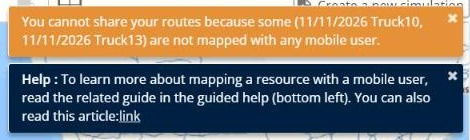

# Tournée non reçue dans l’application mobile

### Prise en main

Lorsque le planificateur partage une tournée depuis le back-office TourSolver, la tournée apparaît dans l’application mobile du livreur. Si la tournée n’apparaît pas, la cause vient généralement du lien entre le livreur et l’utilisateur mobile, des agences, ou de l’application qui doit être actualisée.

* **Avant de commencer** :
  * Le livreur peut se connecter à l’application. Voir [Impossible de se connecter à l’application mobile](file:///oWGpSeZsFYIlc5oQ3d3d/6efde4aa-a174-4035-a760-bfe80bc37a77/app-launch/cannot-log-in-to-the-mobile-app.md).
  * Le livreur ouvre les tournées du jour depuis le **Tableau de bord**. Voir [Tableau de bord](/broken/pages/d25375e20be6cc8be0d499c166135d5909eea9c4).
  * Le planificateur a partagé la tournée avec **Exporter** > **Partager avec l’application mobile**. Voir [Partager une tournée avec l’application mobile](https://nomadia-docs.gitbook.io/products/toursolver/fr/operations-and-route-management/share-a-tour-with-the-mobile-app).

### Explications des fonctionnalités et avantages

* **Utilisateur de l’application mobile** : L’utilisateur qui reçoit les tournées d’un livreur. Chaque livreur doit être associé à un utilisateur mobile.
* **Confirmation du partage** : Après que le planificateur a cliqué sur **Envoyer**, TourSolver indique le nombre de livraisons partagées et le nombre d’e-mails envoyés aux utilisateurs mobiles. Elle confirme que la tournée a été envoyée.
* **Actualiser** : Recharge les tournées dans l’application, sans attendre la synchronisation automatique.

### Tâches courantes avec étapes détaillées

* **Actualiser les tournées dans l’application (livreur)**
  1. Dans l’application, appuyez sur les **trois points** en haut de l’écran.
  2. Appuyez sur **Actualiser**.
  3. Vérifiez la date : la tournée apparaît le jour pour lequel elle a été partagée.
* **Vérifier la confirmation du partage (planificateur)**
  1. Dans le back-office, partagez de nouveau la tournée avec **Exporter** > **Partager avec l’application mobile**.
  2. Après avoir cliqué sur **Envoyer**, lisez la confirmation : le nombre de livraisons partagées et le nombre d’e-mails envoyés.
  3. Si aucun e-mail n’est envoyé, le livreur n’est associé à aucun utilisateur mobile. Associez-le comme décrit ci-dessous.
*   **Associer le livreur à un utilisateur mobile (planificateur)**

    Si un livreur n’est associé à aucun utilisateur mobile, TourSolver ne partage pas la tournée et affiche par exemple : « You cannot share your routes because some (11/11/2026 Truck10, 11/11/2026 Truck13) are not mapped with any mobile user. »

1. Dans le back-office, accédez à **Mes livreurs**.
2. Cliquez sur l’icône **Modifier** du livreur, puis sur l’onglet **Véhicule**.
3. Dans **Utilisateur de l’application mobile**, sélectionnez l’utilisateur du livreur, puis cliquez sur **Enregistrer**.

.jpg>)

4. Partagez de nouveau la tournée.

* **Vérifier les agences (planificateur)**
  1. Dans **Configuration** > **Rôles et profils** > **Gérer les utilisateurs**, vérifiez les **Agences** de l’utilisateur mobile.
  2. Vérifiez que le livreur appartient à l’une de ces agences, dans l’onglet **Général** du livreur dans **Mes livreurs**.
  3. Si nécessaire, ajoutez l’agence du livreur à l’utilisateur dans l’onglet **Agences**, puis cliquez sur **Enregistrer**.

.jpg>)

### Dépannage

* **« You cannot share your routes because some … are not mapped with any mobile user »** : Associez chaque livreur des tournées à un utilisateur mobile, puis partagez de nouveau.
* **La confirmation indique 0 e-mail envoyé** : Vérifiez l’**Utilisateur de l’application mobile** des livreurs et l’adresse e-mail des utilisateurs mobiles.
* **La tournée a été partagée mais n’apparaît pas** : Actualisez l’application avec les **trois points** > **Actualiser**, vérifiez la date de la tournée, et vérifiez que l’utilisateur et le livreur appartiennent à la même agence.

### Conseils de productivité

* 💡 **Associez une fois, partagez tous les jours** : Associez une seule fois chaque livreur à son utilisateur mobile. Les tournées partagées ensuite parviennent automatiquement au livreur.
* 💡 **Vérifiez les compteurs** : Lisez toujours la confirmation du partage. Le nombre d’e-mails envoyés vous indique combien de livreurs ont reçu la tournée.
