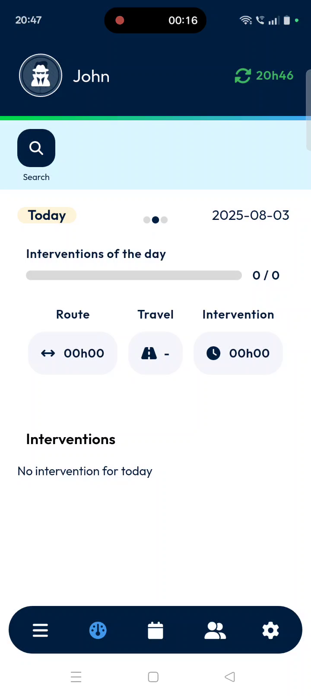
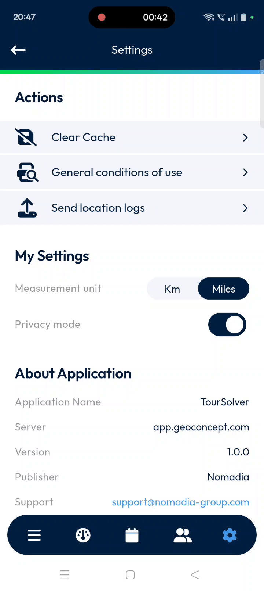
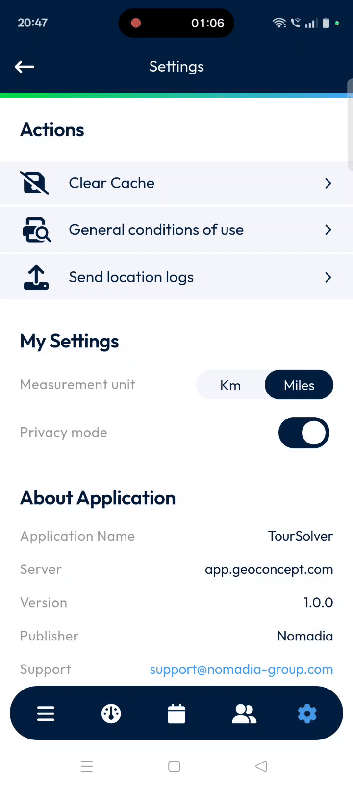
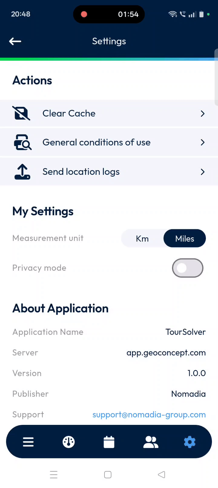

# Paramètres

### 1. Commencer

Bien que les sources fournies ne spécifient pas les exigences système exactes pour l'application TourSolver Mobile ni ses étapes d'installation initiales, cette section vous guidera pour accéder et effectuer les premières configurations essentielles dans les paramètres de l'application.

**1. Accéder à l'écran des paramètres** Pour accéder aux paramètres :

1. **Lancez l'application TourSolver Mobile**.
2. Repérez l'icône **engrenage** sur la barre de navigation inférieure.
3. Appuyez sur le **engrenage**.

4. Vous serez maintenant sur **l'écran Paramètres**. Ici, vous trouverez trois sections principales : **Actions**, **Mes paramètres**, et **À propos de l'application**.
   * _Imaginez une capture d'écran ici montrant l'écran principal des Paramètres avec les trois sections clairement étiquetées._

**2. Configuration initiale (premières étapes importantes)**

* **Définissez votre unité de mesure préférée**:
  1. Sur l'écran Paramètres, accédez à la **Mes paramètres** section.
  2. Touchez l'option « unité de mesure ».
  3. Choisissez votre unité préférée en sélectionnant soit **Kilomètre** ou **Miles** en fonction de votre région ou de votre préférence.

* **Activez le mode confidentialité pour le contrôle des données**:
  1. Sur l'écran Paramètres, également sous **Mes paramètres**, trouvez l'option « Activer le mode confidentialité ».&#x20;
  2. **Basculez** cette option pour **limiter la collecte de données par l'application**.
  3. indiquant le statut actuel (reportez-vous à la Légende des couleurs dans le menu filtre). **Conseil** : Activer le mode confidentialité est une excellente façon de garantir que vos informations personnelles sont traitées conformément aux **normes RGPD**, vous donnant un contrôle total sur la façon dont vos données sont partagées.

***

### 2. Comprendre les fonctionnalités de votre application (sections des Paramètres)

L'onglet Paramètres organise des fonctionnalités utiles en trois sections faciles à comprendre :

* **Actions** : Cette section propose des options pour gérer les performances de votre application et faciliter l'assistance.
  * **Vider le cache** : Cette option aide votre application à fonctionner correctement en supprimant les fichiers temporaires.
    * **Avantage** : Optimise les performances et actualise le contenu obsolète, garantissant que vous voyez toujours les informations les plus récentes.
  * **Conditions générales d'utilisation** : Ici, vous pouvez consulter et lire les avis légaux officiels, les conditions et les définitions qui s'appliquent dans l'application.
    * **Avantage** : Restez informé de vos droits et responsabilités lors de l'utilisation de l'application.
  * **Envoyer les journaux de localisation** : Cette fonctionnalité vous permet d'envoyer en toute sécurité votre historique de localisation directement à l'équipe d'assistance.
    * **Avantage** : Essentiel pour le dépannage ou à des fins de diagnostic si vous rencontrez des problèmes nécessitant une assistance technique.
* **Mes paramètres** : Cette section vous permet de personnaliser votre expérience de l'application.
  * **Unité de mesure** : Choisissez votre unité préférée pour les mesures de distance.
    * **Avantage** : Personnalisez l'application pour afficher les distances en **kilomètres** ou **miles**, ce qui la rend plus pratique et familière pour vous.
  * **Mode confidentialité** : Contrôlez la manière dont vos données personnelles sont collectées par l'application.
    * **Avantage** : En activant cela, vous alignez le traitement des données de l'application sur **normes RGPD**, en vous assurant que vous avez un contrôle total sur vos informations personnelles et la manière dont elles sont partagées.
* **À propos de l'application** : Cette section fournit des informations techniques essentielles sur l'application TourSolver Mobile.
  * **Nom de l'application** : L'application s'appelle **TourSolver**.
  * **Serveur** : Elle synchronise les données en utilisant le serveur `apps.concept.com`.
  * **Version** : Affiche la version actuelle installée, par exemple, `1.0.0`.
  * **Éditeur** : L'application est développée et publiée par **Nomadia**, un leader reconnu dans les solutions de mobilité intelligente.
  * **Assistance** : Fournit l'adresse e-mail d'assistance : `support@nomadiagroup.com` pour toute aide.
  * **Site web** : Donne l'adresse du site officiel : `www.nomadiagroup.com` pour plus d'informations.
    * **Avantage** : Trouvez rapidement des informations importantes sur l'application, y compris les coordonnées de l'assistance, ce qui est utile pour le dépannage ou les demandes de renseignements.

***

### 3. Tâches courantes dans les Paramètres

Voici des instructions pas à pas pour les actions courantes que vous pourriez vouloir effectuer dans l'onglet Paramètres :

* **Comment vider le cache de l'application**:
  1. Depuis l'écran Paramètres, appuyez sur **Vider le cache** sous le **Actions** section.
  2. Une fenêtre de confirmation apparaîtra, demandant « Êtes-vous sûr de vouloir vider le cache de votre application ? »

* **Comment lire les Conditions générales d'utilisation**:
  1. Sur l'écran Paramètres, appuyez sur **Conditions générales d'utilisation** sous le **Actions** section.
  2. Vous serez dirigé vers un nouvel écran où vous pourrez lire les avis légaux complets, les conditions et les définitions.

* **Comment envoyer les journaux de localisation au support**:
  1. Depuis l'écran Paramètres, appuyez sur **Envoyer les journaux de localisation** sous le **Actions** section.
  2. Après avoir appuyé, un message de confirmation apparaîtra, indiquant que « les journaux ont été envoyés avec succès. »

* **Comment changer votre unité de mesure**:
  1. Depuis l'écran Paramètres, localisez le **Mes paramètres** section.
  2. Appuyez sur l'option pour **unité de mesure**.
  3. Choisissez votre unité préférée en sélectionnant soit **Kilomètre** ou **Miles** en fonction de votre région ou de votre préférence.

* **Comment activer le mode confidentialité**:
  1. Depuis l'écran Paramètres, localisez le **Mes paramètres** section.
  2. Trouvez l'option « Activer le mode confidentialité ».&#x20;
  3. **Basculez** le commutateur à côté de cette option pour le régler **sur** (pour limiter la collecte de données) ou **hors**.

### flèche de retour&#x20;

* **Vidage régulier du cache** : Prenez l'habitude de **Vider le cache** périodiquement. Cela garde votre application rapide et réactive, évitant les ralentissements dus à l'accumulation de fichiers temporaires.
* **Contrôle des données** : Profitez de la **Mode confidentialité**. Si la confidentialité des données est une préoccupation, activer cette fonctionnalité vous donne un meilleur contrôle sur la manière dont vos informations sont traitées, en accord avec les normes internationales de confidentialité.
* **Accès rapide à l'assistance** : Si vous rencontrez des problèmes techniques, rappelez-vous que la fonctionnalité **Envoyer les journaux de localisation** peut être un moyen rapide de fournir des informations de diagnostic essentielles à l'équipe d'assistance. Vous pouvez également trouver l' **adresse e-mail d'assistance** du client **site web** sous « À propos de l'application » pour une assistance directe.
* **Restez informé** : Examinez périodiquement les **Conditions générales d'utilisation** pour rester à jour sur tout avis légal ou conditions qui régissent votre utilisation de l'application.
